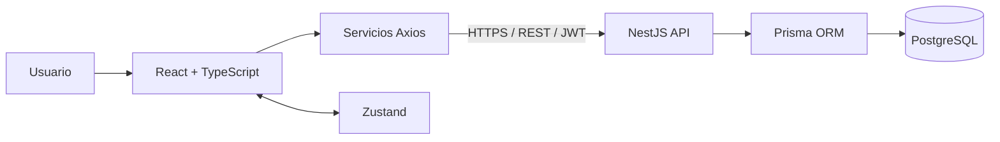
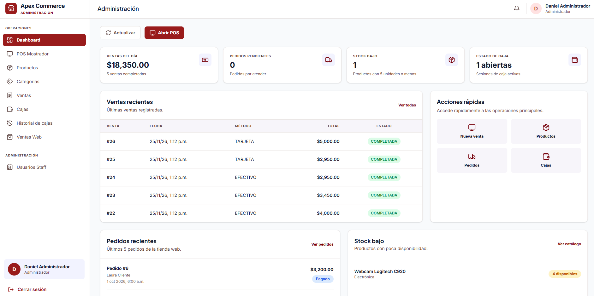
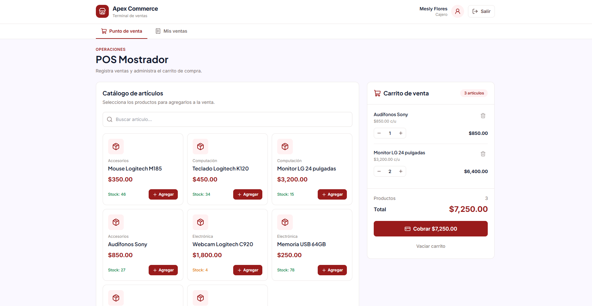
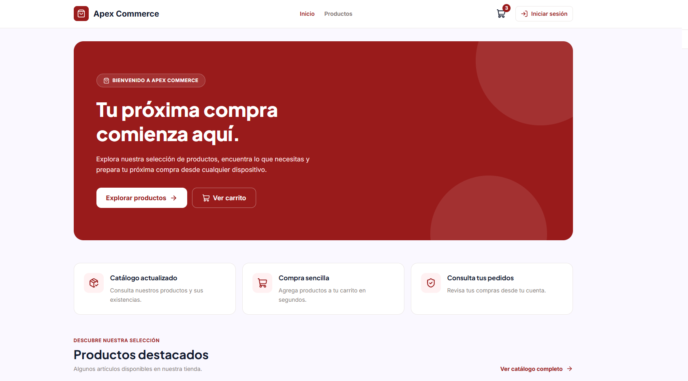
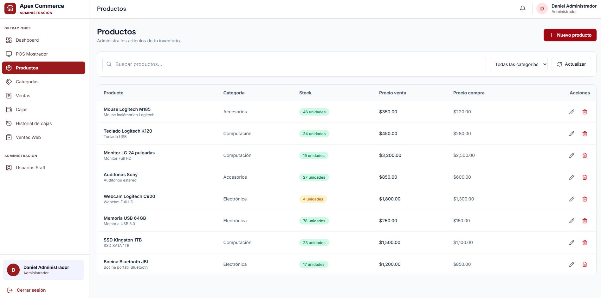
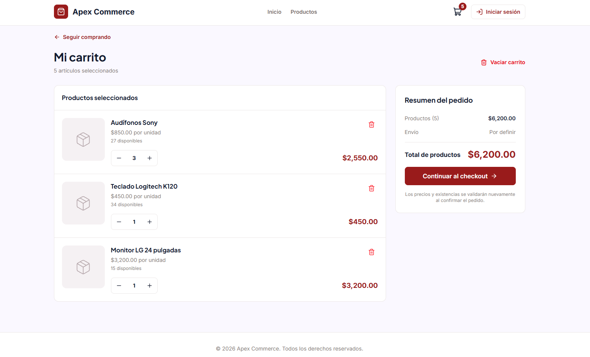
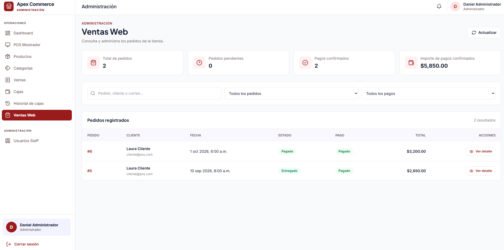

# Apex Commerce | Frontend


[](https://apex-commerce-one.vercel.app/)
[](https://github.com/dino1051/EntregableNest)

## Enlaces del proyecto

- [Aplicación desplegada](https://apex-commerce-one.vercel.app/)
- [Repositorio del backend (NestJS)](https://github.com/dino1051/EntregableNest)

## Descripción

Apex Commerce es una aplicación web de gestión comercial que integra un sistema de punto de venta (POS) y una tienda en línea en una misma plataforma.

Este repositorio contiene el frontend, desarrollado con React y TypeScript, que consume una API REST construida con NestJS, Prisma y PostgreSQL. La aplicación ofrece interfaces diferenciadas según el rol del usuario y una arquitectura modular orientada a la reutilización de componentes.

## Funcionalidades

### Administrador

- Dashboard con indicadores de ventas, pedidos, sesiones de caja y stock bajo.
- Administración de productos y categorías.
- Consulta del historial y detalle de ventas de mostrador.
- Gestión y seguimiento de pedidos web.
- Administración de sesiones de caja.
- Acceso al punto de venta.

### Cajero

- Registro de ventas desde el POS.
- Selección de artículos y cantidades.
- Registro del método de pago.
- Apertura y cierre de sesiones de caja.
- Consulta de ventas propias y sus detalles.

### Cliente web

- Consulta del catálogo de productos.
- Carrito de compras.
- Registro e inicio de sesión.
- Generación y consulta de pedidos web.

> El proyecto se encuentra en desarrollo. La integración del pago externo y la verificación de los flujos completos pueden requerir configuración adicional.

## Tecnologías utilizadas

| Tecnología      | Propósito                              |
| --------------- | -------------------------------------- |
| React           | Interfaces y componentes reutilizables |
| TypeScript      | Tipado estático                        |
| Vite            | Entorno de desarrollo y compilación    |
| Tailwind CSS    | Estilos y diseño responsive            |
| Zustand         | Gestión del estado global              |
| React Router    | Navegación y rutas protegidas          |
| Axios           | Comunicación con la API REST           |
| React Hook Form | Gestión de formularios                 |
| Zod             | Validación de datos                    |
| Lucide React    | Iconografía                            |
| React Hot Toast | Notificaciones                         |
| JWT             | Autenticación mediante tokens          |

## Arquitectura



### Estructura de carpetas

Estructura representativa de los módulos del frontend:

```text
src/
├── components/    # Componentes reutilizables y layouts
├── hooks/         # Hooks personalizados
├── lib/           # Configuración de Axios y utilidades
├── pages/         # Vistas de la aplicación
├── schemas/       # Esquemas de validación Zod
├── services/      # Comunicación con la API
├── store/         # Estado global con Zustand
└── types/         # Interfaces y tipos TypeScript
```

## Autenticación y autorización

La aplicación utiliza JWT para autenticar las solicitudes. Zustand administra la sesión del usuario y Axios incorpora el token en las solicitudes autenticadas mediante un interceptor.

| Rol          | Acceso principal                     |
| ------------ | ------------------------------------ |
| `ADMIN`      | Panel administrativo y POS           |
| `CAJERO`     | Punto de venta y operaciones de caja |
| `CLIENTEWEB` | Tienda en línea y pedidos propios    |

Las rutas protegidas restringen la navegación según el rol. La autorización efectiva de las operaciones debe ser validada también por el backend mediante sus guards y reglas de acceso.

## Instalación y ejecución local

### Requisitos

- Node.js en una versión compatible con el Vite instalado.
- npm.
- Git.
- Una instancia disponible del backend de Apex Commerce.

### 1. Clonar el repositorio

```bash
git clone <URL_DEL_REPOSITORIO>
cd <CARPETA_DEL_REPOSITORIO>
```

### 2. Instalar dependencias

```bash
npm install
```

### 3. Configurar las variables de entorno

Crear un archivo `.env` en la raíz del proyecto y configurar la URL de la API. Ejemplo para un backend local (ajustar la URL y el puerto a la configuración del backend):

```env
VITE_API_URL=http://localhost:3000/api
```

Las variables con prefijo `VITE_` son públicas en el navegador. No deben contener contraseñas, secretos JWT ni claves privadas.

### 4. Iniciar el servidor de desarrollo

```bash
npm run dev
```

Abrir la dirección que indique Vite, normalmente `http://localhost:5173`.

## Compilación para producción

```bash
npm run build
npm run preview
```

La compilación genera los archivos estáticos en `dist/` con la configuración predeterminada de Vite.

## Integración con el backend

El código fuente de la API y sus instrucciones de instalación se encuentran en [EntregableNest](https://github.com/dino1051/EntregableNest).

Principales recursos de la API utilizados por el frontend:

| Recurso          | Descripción                         |
| ---------------- | ----------------------------------- |
| `/auth/login`    | Inicio de sesión                    |
| `/auth/register` | Registro de clientes                |
| `/auth/me`       | Información del usuario autenticado |
| `/articulos`     | Productos e inventario              |
| `/categorias`    | Categorías de productos             |
| `/ventas`        | Ventas de mostrador                 |
| `/ventas-web`    | Pedidos de la tienda en línea       |
| `/sesion-caja`   | Sesiones de caja                    |

## Despliegue

La arquitectura de despliegue del proyecto contempla:

- **Vercel:** frontend React.
- **Render:** API NestJS.
- **Neon:** base de datos PostgreSQL.

Para desplegar el frontend en Vercel, configurar `VITE_API_URL` con la URL pública de la API y habilitar la reescritura de rutas de la SPA hacia `index.html` si todavía no está configurada. El backend debe permitir el origen del frontend mediante CORS.

## Capturas de pantalla

<table>
  <tr>
    <td align="center">
      <strong>Dashboard administrativo</strong>
      
    </td>
    <td align="center">
      <strong>Punto de venta</strong>
      
    </td>
  </tr>
  <tr>
    <td align="center">
      <strong>Tienda en línea</strong>
      
    </td>
    <td align="center">
      <strong>Gestión de productos</strong>
      
    </td>
  </tr>
  <tr>
    <td align="center">
      <strong>Gestion de carrito</strong>
      
    </td>
    <td align="center">
      <strong>Gestión de pedidos</strong>
      
    </td>
  </tr>
</table>

## Estado del proyecto

Proyecto Full Stack en desarrollo, orientado a aplicar conocimientos de arquitectura de software, consumo de APIs REST, gestión de estado, autenticación, control de roles y desarrollo de interfaces responsive.

## Autor

Desarrollado como proyecto de portafolio Full Stack.
